# Blindspot

> **Don't just collect information. Investigate it.**

You give Blindspot a decision question and the sources you found. It tells you what is **supported, conflicting, outdated, missing or unverified**, backs every finding with a quote from the source, and tells you **what to verify before you decide**.

Built for the Shinchan Online Hackathon 2026 (Devengers × Unstop), problem statement **"Digital Dark Spot"**.

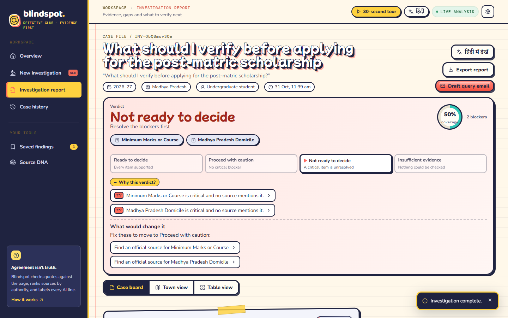

**The pitch in one line:** AI proposes, code verifies. The AI suggests what to look for and which sentence supports each claim; plain code checks that sentence is really on the page, ranks who said it, and decides every status and the verdict.

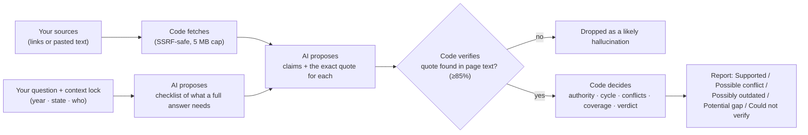

## Try it in 30 seconds: Trap Lab

We hid **five traps in five invented test pages** (labelled as such). One click on **Catch the traps** runs a real investigation: the pages are fetched by the normal fetcher, the AI reads them, and code checks every quote. The report then shows a scorecard computed from its own findings:

| Planted trap | What Blindspot reports |
|---|---|
| A blog says self-declaration is enough; the official notice says an income certificate is mandatory | **Possible conflict**, official source ranked first |
| The scholarship amount appears only in last year's notice | **Possibly outdated** |
| No page says how the scholarship is renewed | **Potential gap** |
| The news page copies the blog word for word | **Source DNA: 2 pages, 1 voice** |
| The domicile rule found is for Rajasthan, not your state | **Could not verify** (different context) |

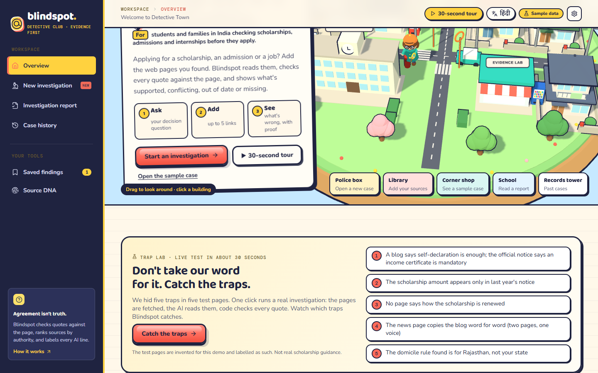
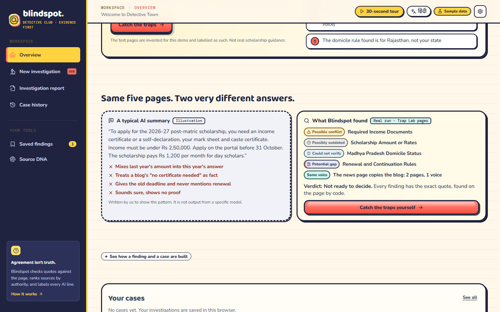

Then **Simulate: the authority updates the notice** and **Re-check**: Blindspot re-runs the case and shows exactly what changed (the deadline moves 30 November → 15 December).

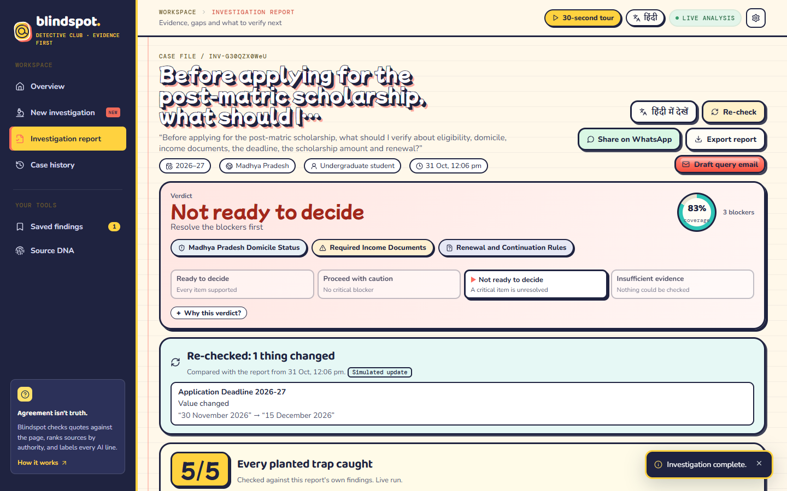

**Also built for real use:** ask your question out loud in Hindi or English (browser speech recognition), read the whole report in Hindi, share the verify-next list on WhatsApp, draft an email to the authority, and a **Counsellor board** for volunteers who help many applicants (tag each case with a student's name; the board sorts by who needs attention first and exports a CSV).

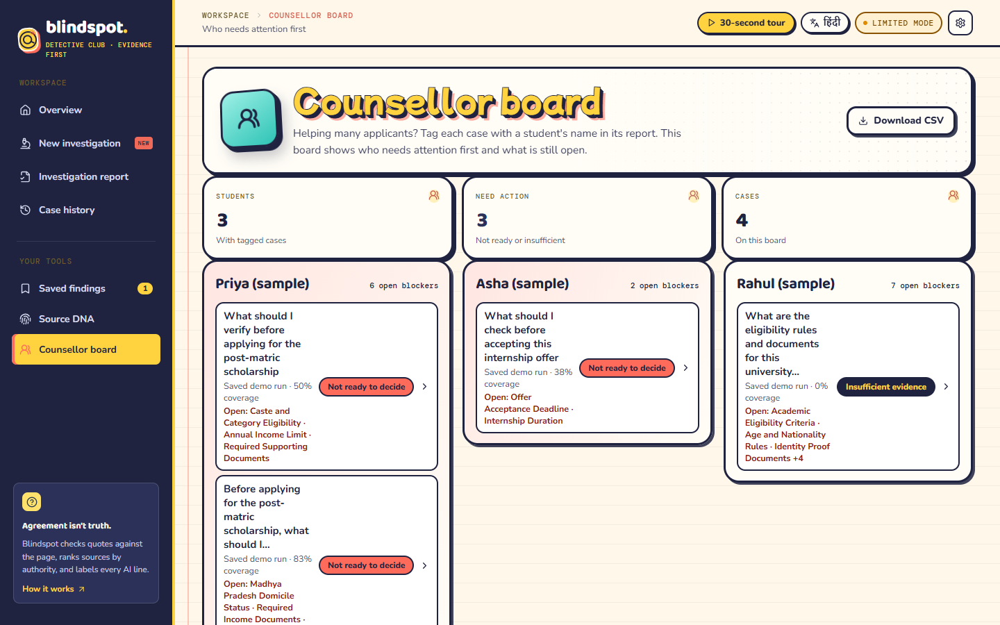

## The problem

Students and families decide on scholarships, admissions, jobs and government schemes using information scattered across many websites. Some pages are from last year's cycle, some disagree, and some key details (renewal rules, the current deadline) are never mentioned anywhere. Search finds pages and summarizers condense them, but **nothing tells you what is missing or unreliable for your decision**.

**Who it's for:** first-generation applicants with no one to double-check for them, and the counsellors and volunteers who help many applicants.

## How it works (the USP)

**1. Checklist first.** Before reading any source, Blindspot asks: *what must a complete answer to this question contain?* (6–10 items: eligibility, documents, deadline, renewal…). Every source is then tested against that list. This is how Blindspot finds **missing** information, not just conflicts: an item that no source mentions becomes a *Potential gap*.

**2. Quote check.** For every claim, the LLM must return the exact sentence it relied on. Code then fuzzy-matches that quote against the text we actually fetched (rapidfuzz `partial_ratio` ≥ 85 after normalising whitespace, quotes and ₹/Rs.). A claim whose quote is not on the page is **dropped as a likely hallucination**. The UI says **"QUOTE FOUND IN SOURCE · 97%"**, never "verified true": a quote on a page shows what the page says, not that it's right.

**3. Context lock.** You fix the year/cycle, state and applicant category. A claim from the 2025–26 cycle is reported as *Possibly outdated*, and a rule for another state as a *different context*. They are not reported as conflicts.

**4. Authority over agreement.** Every source is tiered **Primary** (`.gov.in`, `.nic.in`, scheme portals) › **Institutional** (`.ac.in`, `.edu`, universities) › **Secondary** (blogs, news) › **Unverified** (unreadable). One official page outranks three blogs that copied each other: its value is shown, and the blogs stay visible as a possible conflict.

**5. Honest uncertainty.** A page that couldn't be read (blocked, JavaScript-only, robots.txt) makes items **Could not verify**, never "missing". Every AI-written line (notes, questions, next steps, email drafts, Hindi translation) is labelled **"AI suggestion · may be wrong"** in a dashed purple box.

**6. Coverage + blockers, not a magic score.** Coverage % (how much of the checklist has evidence), the **critical** items that are conflicting, outdated or missing, and a plain verdict: *Not ready to decide*, *Proceed with caution*, or *Ready to decide*.

## Architecture

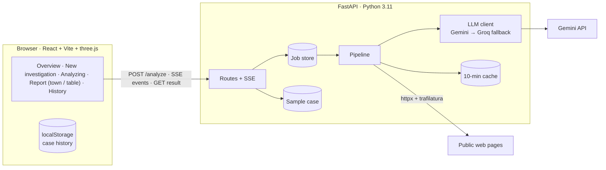

All external calls happen in the backend. Keys live only in `backend/.env`. Full design: [docs/ARCHITECTURE.md](docs/ARCHITECTURE.md).

**Working on the code?** Folder layout, layering rules, naming conventions, error-handling policy and "how to add a page / API route / UI string" are in [docs/CODEBASE.md](docs/CODEBASE.md).

### Pipeline: what is AI and what is code

| Step | Kind | What it does |
|---|---|---|
| `checklist` | **AI** | Lists 6–10 items a complete answer must cover (≥ 3 critical). Static fallback list if the LLM is down. |
| `fetch` | Code | httpx + trafilatura, 12 s timeout, honest User-Agent, respects robots.txt, pasted-text override. |
| `classify` | Code | Credibility tier from the domain; year/cycle detection with regex. |
| `extract` | **AI** | Per source, per item: value + exact quote + cycle, or `not_found`. Prompt: *"Quote text exactly as it appears; if not present, return not_found; never infer."* |
| `verify` | Code | Finds each quote in the fetched text; drops unmatched claims. |
| `compare` | Code (+ narrow AI) | Context lock, authority, missing vs unverified. AI only answers "do these two values mean the same?" when rules can't tell. |
| `score` | Code | Coverage, blockers, verdict. |
| `actions` | **AI** | Verify-next list, unanswered questions, notes. Template fallback. |

The LLM proposes and code decides. Every LLM output is validated against a Pydantic schema, retried once on invalid JSON, then falls back to Groq, then to a template, so a job never crashes.

## Your tools

- **Saved findings:** pin any finding from the evidence drawer. It keeps a snapshot of the quotes and sources, lets you add your own note (for example what the office told you on the phone), filters by status and copies everything as text. Stored in your browser only.
- **Source DNA lab:** paste 2–5 page texts (or press *Load example*) and see the DNA instantly. It runs in the browser, with no AI and no upload, using a line-for-line port of the backend algorithm (both give identical numbers).
- **Source DNA:** five blogs repeating one claim are one voice, not five. For every pair of readable sources, plain code (no AI) measures how much of the smaller page appears in the other, using five-word phrases, and lists sentences copied word for word. At 50% or more the pages are grouped as **one voice**; at 15% they **share passages**. The report's source list shows a "Same voice as …" badge. The sample case's DNA is illustrative and labelled.

## Statuses and scoring rules

| Status | UI label | Meaning |
|---|---|---|
| `supported` | Supported | Verified evidence in the locked context; strongest source shown |
| `conflict` | Possible conflict | ≥ 2 verified claims in the same context with different meaning |
| `outdated` | Possibly outdated | Only evidence is from a cycle earlier than the locked year |
| `missing` | Potential gap | No readable source mentions it |
| `unverified` | Could not verify | No readable source could cover it, or evidence only for another state |

- **Coverage** = items with ≥ 1 verified claim ÷ total items.
- **Blocker** = a *critical* item that is a possible conflict, possibly outdated, a potential gap, or could not verify.
- **Verdict** (strictest first, so less evidence never gives a friendlier answer):
  1. *Insufficient evidence*: coverage is 0%, or no source could be read and analysed. It tells you to paste the page text.
  2. *Not ready to decide*: any blocker.
  3. *Proceed with caution*: no blockers, but something isn't fully supported.
  4. *Ready to decide*: every item supported. A unit test walks evidence down step by step and checks the verdict never gets friendlier.
- **Outdated** = claim cycle earlier than the locked cycle (a bare date in 2025 is older than a 2026–27 lock).
- **Undated claims** can't be placed in the locked context, so they cannot overturn a dated claim. They are shown with an **Undated** badge.
- **Missing vs unverified:** "missing" only when at least one source was read and analysed; otherwise "unverified".

All of these are pure functions with tests in [backend/tests](backend/tests).

## Safety and honesty

- **No SSRF.** Before any fetch the URL is resolved and **every** IP must be public (not private, loopback, link-local, multicast, reserved or unspecified, IPv4 and IPv6). `localhost`, `*.localhost`, `*.internal`, metadata hosts and disguised IPs (decimal, octal, hex) are refused. Only ports 80/443 are allowed. The connection goes to the validated IP (Host header + TLS SNI kept), so DNS rebinding can't swap it. Redirects are followed by hand (max 5) and re-checked, and bodies are capped at 5 MB. A refused source shows "Could not read — this address isn't allowed" and the run continues.
- **Strict API input.** The same rules as the form: a trimmed question of 10–500 characters, https only, no duplicate pages, dropdown values only, pasted text tied to a listed source (max 50,000 characters each). Errors come back as `{error:{code,message}}`.
- **Unguessable case IDs** (`INV-` + 10 random URL-safe characters) and a rate limit of 10 investigations per minute per IP.
- **Honest AI status.** `/health` makes a cheap cached test call and reports `llm_ok` + reason. The header shows **LIVE ANALYSIS** only when the AI really answers; otherwise **LIMITED MODE**, with the reason on hover. Gemini calls go through a model chain (each model has its own free quota), and every failure is logged with the real reason (quota, overload, retired model, bad key).

## Run it

**Requirements:** Python 3.11+, Node 20+.

```bash
# Backend
cd backend
python -m venv .venv
.venv/Scripts/pip install -r requirements.txt     # macOS/Linux: .venv/bin/pip
cp ../.env.example .env                           # add GEMINI_API_KEY (free key from Google AI Studio)
.venv/Scripts/python -m uvicorn app.main:app --port 8000

# Frontend (new terminal)
cd frontend
npm install
echo VITE_API_BASE_URL=http://localhost:8000 > .env
npm run dev                                       # http://localhost:5173
```

| Variable | Where | Purpose |
|---|---|---|
| `GEMINI_API_KEY` | backend/.env | Live analysis (free tier works) |
| `GEMINI_MODEL` | backend/.env | Main model, default `gemini-3.5-flash` |
| `GEMINI_FALLBACK_MODELS` | backend/.env | Tried in order on quota/overload, default `gemini-3.5-flash-lite,gemini-flash-lite-latest,gemini-2.5-flash` |
| `GROQ_API_KEY`, `GROQ_MODEL` | backend/.env | Optional fallback LLM |
| `ALLOWED_ORIGINS` | backend/.env | CORS, comma-separated |
| `VITE_API_BASE_URL` | frontend/.env | Backend URL; leave empty for frontend-only demo |

### Demo mode

- **Sample case:** with **no API key**, or when you click **Try the sample case**, Blindspot shows the bundled scholarship case with a visible **Sample data, illustrative** badge. It contains all five statuses. **Sample quotes, URLs and dates are illustrative, not real scholarship guidance.**
- **Demo mode switch** (⚙ settings in the top bar): adds **3 saved real runs** (scholarship, university admission, internship) to Case history, labelled **Saved demo run**. While it is on, if the backend, network or AI fails, a new investigation replays the closest saved run instead of failing, so a live demo always works. A fourth recorded run is **Trap Lab** (`python -m scripts.trap_run --save`). Regenerate the first three with `backend/.venv/Scripts/python -m scripts.demo_cases` (needs a working key). **Clear demo data** in the same menu removes demo runs and sample items and keeps your own cases.

### Tests

```bash
cd backend && .venv/Scripts/python -m pytest          # 130 tests: rules, verdicts, SSRF, validation, pasted-text trust, translation cache, cancel
cd frontend && npm run build && npm run screenshots   # Playwright walkthrough; fails on console errors
node scripts/qa-check.mjs                             # 18 browser checks: badge, form, routing, focus, names
node scripts/polish-check.mjs                         # 36 checks: every page at 1440 and 390 px, tabs, legend, export, Hindi timing, WebGL
OFFLINE=1 node scripts/polish-check.mjs               # demo mode with the backend unreachable
node scripts/pasted-case.mjs                          # a live pasted-text case end to end
node scripts/traplab-check.mjs                        # Trap Lab live and offline (OFFLINE=1)
node scripts/recheck-check.mjs                        # re-check diff, WhatsApp link, voice button
node scripts/counsellor-check.mjs                     # counsellor board, tagging, CSV
```

### Live run

```bash
cd backend && .venv/Scripts/python -m scripts.live_run   # needs GEMINI_API_KEY; writes docs/live-run.json
```

> **Recorded live run (30 Oct 2026, Gemini 2.5 Flash):** question *"What should I verify before applying for the post-matric scholarship?"*, context 2026–27 · Madhya Pradesh · undergraduate, three real sources: `scholarships.gov.in`, `socialjustice.gov.in/schemes/25` and a Wikipedia article.
> - Both gov.in pages were read and ranked **Primary**. Wikipedia refused the bot (403) and was shown as **Could not verify**.
> - All 6 quotes the AI proposed were found in the fetched page text (0 dropped).
> - Caste eligibility, domicile and academic criteria came only from **2020–21** guidelines, so with a 2026–27 lock they were flagged **Possibly outdated**.
> - Income limit, document list, deadline and amount appear in neither page, so each became a **Potential gap**.
> - Verdict: **Not ready to decide** (60% coverage, 6 blockers, 6 verify-next steps). Full output: [docs/live-run.json](docs/live-run.json).
>
> 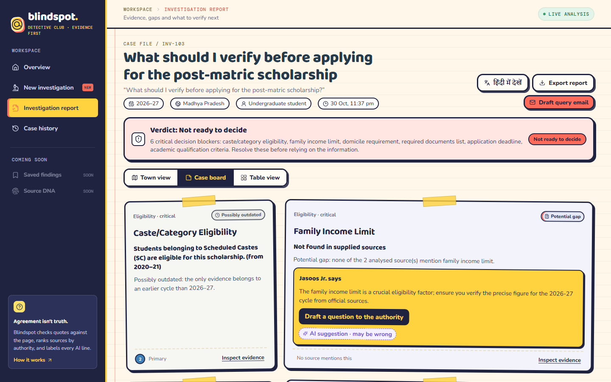

## Screenshots

| | |
|---|---|
| 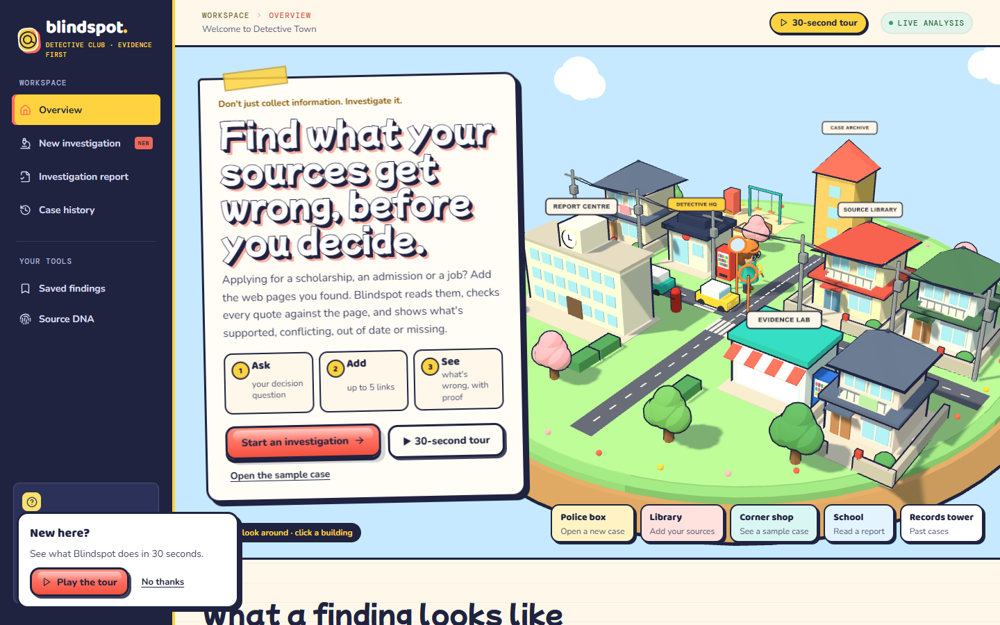 | 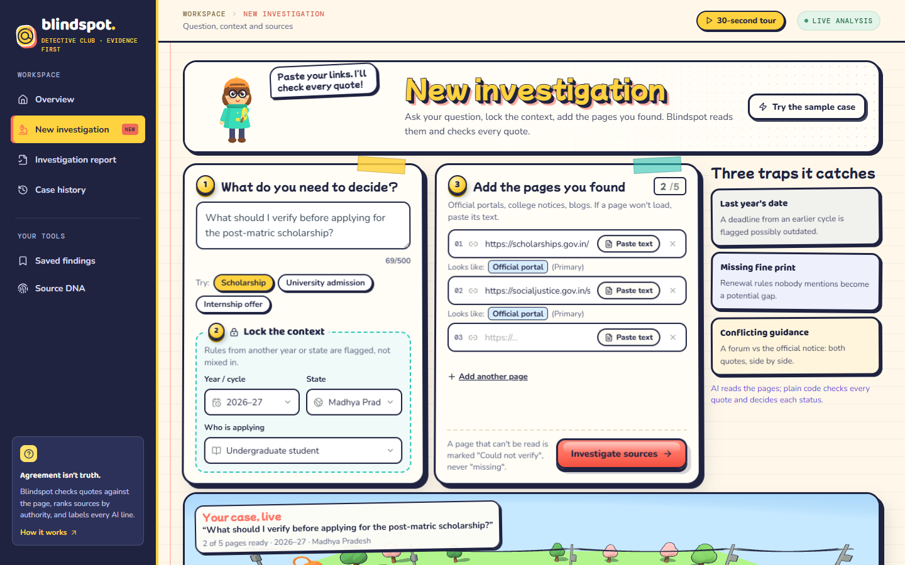 |
| 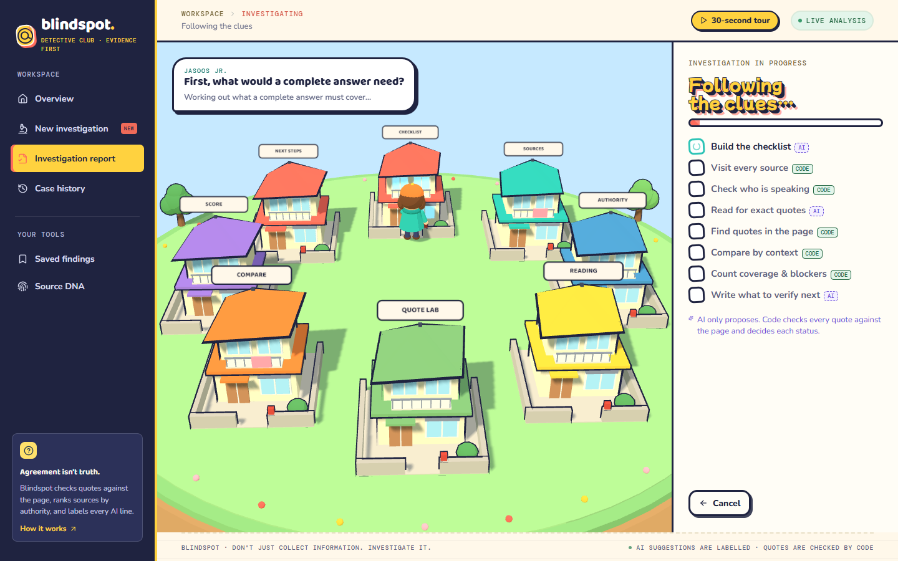 | 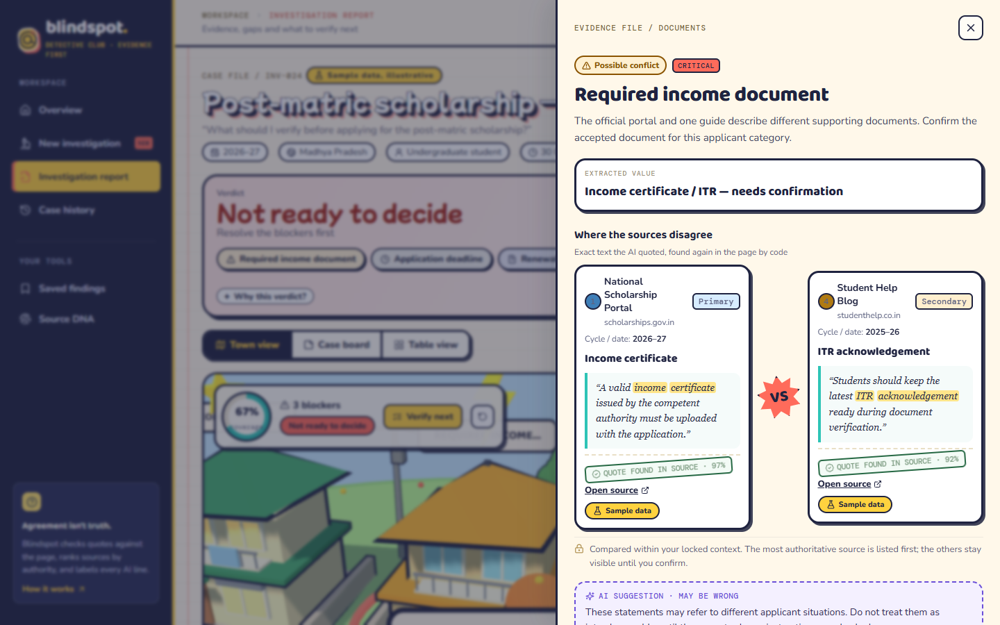 |
| 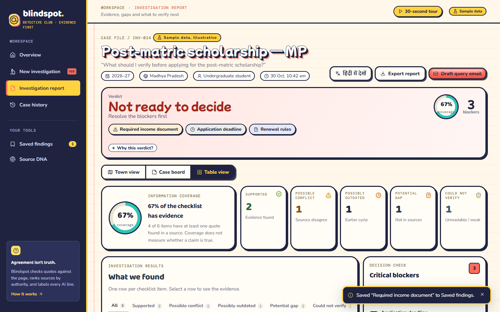 | 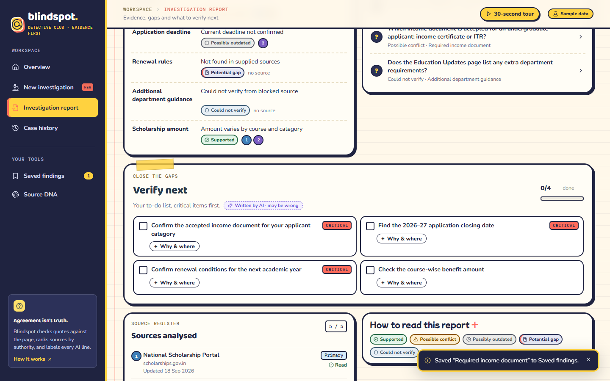 |
| 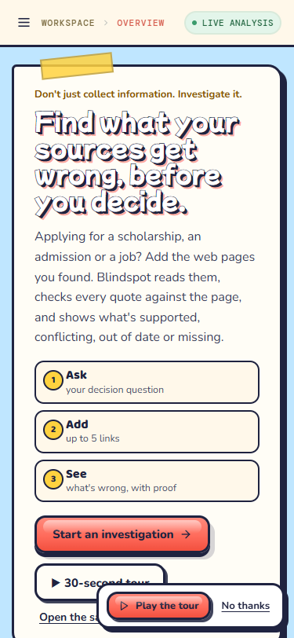 | 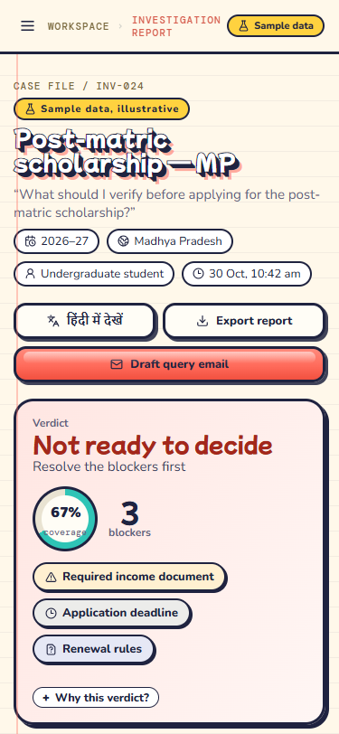 |

## Limitations (honestly)

- **Dynamic pages:** JavaScript-only or login-walled pages can't be read; they become *Could not verify*. Use **Paste text instead**.
- **Blocked sites:** some sites refuse bots (e.g. Wikipedia returns 403 to our User-Agent). We don't evade blocks.
- **A found quote is not proof.** It shows the source says something, not that it's true or current.
- **LLM variability:** the checklist and extraction can differ between runs. Results are cached for 10 minutes so a demo is repeatable, and the quote check removes invented quotes, but a real quote can still be paired with the wrong checklist item.
- **Cycle detection** uses regex; unusual date formats may be missed (the claim is then marked Undated).
- **PDFs** aren't read yet.
- History is stored only in your browser.

## Decisions

Logged in full in [docs/ARCHITECTURE.md §10](docs/ARCHITECTURE.md). Highlights:
- `pasted_text` is a `{url: text}` map so each source can carry its own pasted text.
- `/analyze` returns an id; progress streams over SSE; the result comes from `GET /analyze/{id}`.
- "Could not verify" items are **not** blockers (the old frontend counted them); they lead to *Proceed with caution*.
- The original frontend's mascot resembled an existing cartoon character. It was replaced by **Jasoos Jr.**, an original character built from three.js primitives (and a CSS version on the home page).
- **The world:** Detective Town is a cel-shaded Japanese suburb built only from three.js primitives, with ink outlines that match the UI's 3px strokes. It has two-storey houses with tiled roofs and balconies, a police box (Detective HQ), a school with a clock (Report Centre), a corner shop with vending machines (Evidence Lab), power lines, traffic mirrors, sakura trees and a park. It contains **no Shinchan characters or likenesses**: the event theme inspires the setting, and the characters are our own.
- **Performance:** static geometry is merged by material, giving about 190 draw calls and 35k triangles for the whole town. It runs at a steady 60 fps on a laptop GPU, with one shadow light and pixel ratio capped at 2.
- **UI patterns:** 21st.dev was used for pattern research (hero with a live product preview, feature explanations, stat treatments). Its components are Tailwind/shadcn, so the chosen patterns were rebuilt natively in our CSS tokens instead of adding a UI kit mid-build. Google Stitch wasn't available in this environment.
- **Accessibility pass:** WCAG AA contrast was checked with a ratio script (coral buttons use ink text). Status is never shown by colour alone, focus is trapped in the drawer, toggles use `aria-pressed`, and deleting a case can be undone.
- The sample case is **hand-authored** (it must match the brief exactly). Its statuses illustrate each state. The live pipeline applies the rules above strictly.

## Future work

PDF and photo sources · use Source DNA inside the scoring (count copied sources once) · permitted auto-discovery of sources · browser extension · shareable report links · more Indian languages.

## AI-usage disclosure

- **In the product:** Google Gemini (with optional Groq fallback) builds the checklist, extracts quoted claims, judges "same meaning?" for ambiguous value pairs, and writes notes, questions, next steps, email drafts and Hindi translations. Statuses, coverage, blockers and the verdict are computed by deterministic code. Every AI-written line is labelled in the UI.

## Credits

Fonts: Baloo 2, Nunito, DM Mono (Google Fonts) · Icons: lucide-react · 3D: three.js · Text extraction: trafilatura · Fuzzy matching: rapidfuzz. Jasoos Jr. and the town are original, built from code primitives. No third-party character assets are used.
