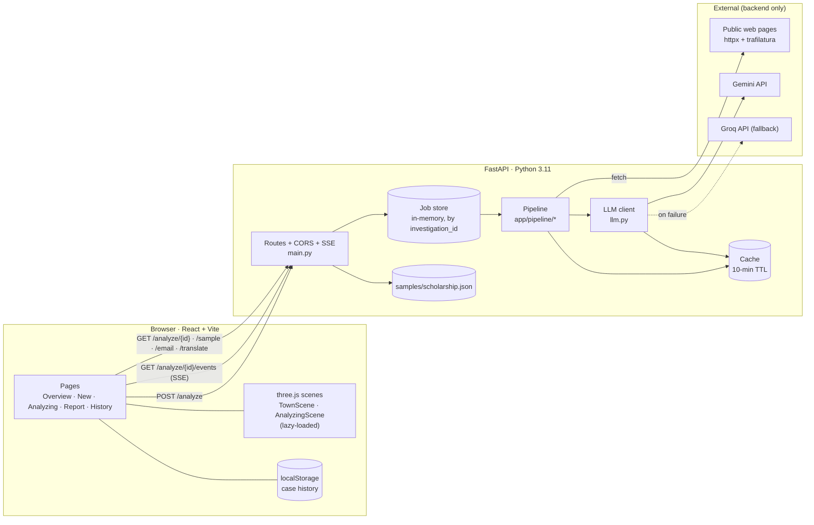
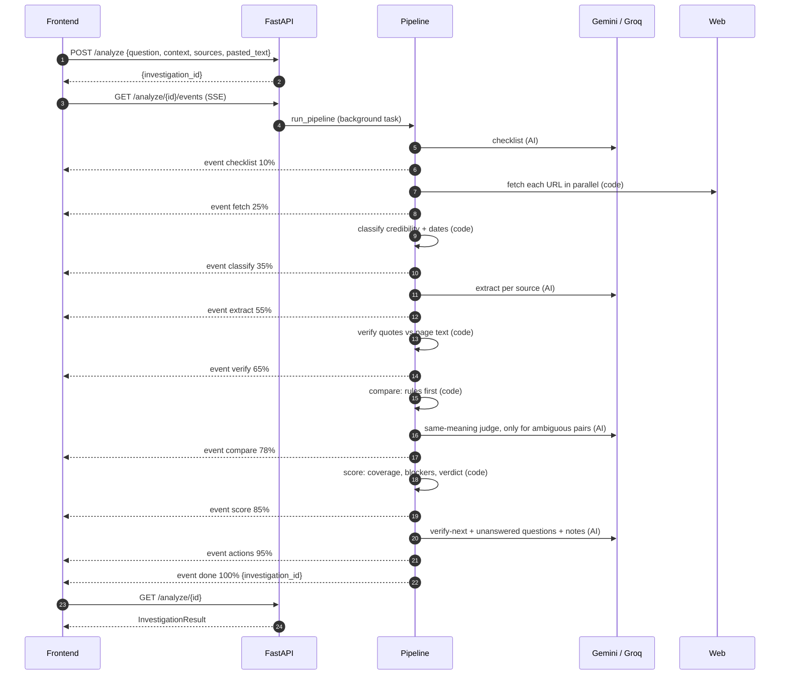

# Blindspot: Architecture

This is the single reference for how Blindspot is built. If code disagrees with this file, fix one of them in the same commit.

## 1. System overview



**Hard boundaries**
- The browser never calls an external service. Every web fetch and LLM call goes through the backend.
- API keys live only in `backend/.env`.
- `backend/app/models/schemas.py` is the single source of truth for the API contract. The frontend mirrors it in `frontend/src/lib/contract.js` (JSDoc types plus status constants).

## 2. Repository layout

```
Blindspot/
├─ backend/
│  ├─ app/
│  │  ├─ main.py            routes, CORS, SSE, job runner
│  │  ├─ models/            Pydantic v2: schemas.py (API contract), pipeline.py (internal)
│  │  ├─ config.py          env loading (pydantic-settings)
│  │  ├─ cache.py           TTL cache (in-memory + optional disk JSON)
│  │  ├─ llm.py             Gemini client, JSON mode, validate, retry, Groq fallback
│  │  ├─ jobs.py            in-memory job store + asyncio.Queue per job for events
│  │  ├─ pipeline/
│  │  │  ├─ __init__.py     run_pipeline(req, emit) orchestrator
│  │  │  ├─ fetch.py        httpx + trafilatura, 12s timeout, pasted-text override
│  │  │  ├─ classify.py     credibility tiers + year/cycle detection
│  │  │  ├─ checklist.py    LLM → 6–10 checklist items
│  │  │  ├─ extract.py      LLM per source → per-item claim | not_found
│  │  │  ├─ verify.py       rapidfuzz quote match, drop unmatched
│  │  │  ├─ compare.py      rules (context lock, authority) + LLM same-meaning judge
│  │  │  ├─ score.py        coverage, blockers, verdict (pure)
│  │  │  └─ actions.py      LLM → verify-next checklist, unanswered questions
│  │  ├─ prompts/           *.md prompt templates
│  │  └─ samples/scholarship.json
│  ├─ tests/
│  ├─ requirements.txt
│  └─ .env                  (git-ignored)
├─ frontend/
│  └─ src/
│     ├─ main.jsx, app/     entry + shell (see docs/CODEBASE.md for the full layout)
│     ├─ pages/             Overview, NewInvestigation, Analyzing, Report, History
│     ├─ components/        Sidebar, Topbar, StatusPill, EvidenceDrawer, ConflictCompare,
│     │                     FindingsTable, KeyFacts, UnansweredQuestions, VerifyNext,
│     │                     BlockersPanel, SourceRegister, Legend, EmailModal, SampleBadge,
│     │                     AiNote, QuoteStamp
│     ├─ three/             townKit.js, JasoosJr.js, World3D.jsx, TownScene.jsx, AnalyzingScene.jsx
│     ├─ lib/               api.js, history.js, status.js, contract.js, a11y.js
│     ├─ data.js            sample (mirrors scholarship.json)
│     └─ styles/            tokens.css, base.css, town.css, report.css, print.css
├─ docs/                    PRD, ARCHITECTURE, PLAN, RULES, CHECKLIST
├─ README.md, SUBMISSION.md
└─ .env.example
```

## 3. Pipeline



### AI vs deterministic

| Step | Module | Kind | Input → Output |
|---|---|---|---|
| checklist | `checklist.py` | **AI** | question + context → 6–10 `{id, title, category, critical, why}` |
| fetch | `fetch.py` | Code | URLs + pasted text → `FetchedSource{id, url, host, text, state, error}` |
| classify | `classify.py` | Code | host + text → `type` (credibility), `date` (published/updated), detected cycles |
| extract | `extract.py` | **AI** | checklist + one source's text → per item `{value, exact_quote, date_or_cycle}` or `not_found` |
| verify | `verify.py` | Code | claim + source text → `quote_match` score; drop if < 85 |
| compare | `compare.py` | Code + **AI** (narrow) | verified claims per item → status + chosen value; AI only answers "same meaning? yes/no" |
| score | `score.py` | Code | findings → coverage, blockers, verdict |
| actions | `actions.py` | **AI** | findings → verify-next checklist, unanswered questions, per-finding notes (all labelled AI) |

Every AI output is validated by a Pydantic model. The checklist, extraction and judge outputs only *propose*; code decides the status.

### Step details

**fetch.py**
- `httpx.AsyncClient(timeout=12, follow_redirects=True)`, UA `BlindspotBot/1.0 (+repo URL; hackathon research)`, checks `robots.txt` (`urllib.robotparser`, cached).
- `trafilatura.extract(html, include_tables=True)` → plain text. Fallback: BeautifulSoup `get_text`.
- `pasted_text[url]` present → skip the network; `state="Pasted"`.
- Any error, a 4xx/5xx, a robots disallow, or extracted text < 200 chars → `state="Blocked"`, `type="Unverified"`, text empty.
- Fetches are cached by URL for 10 minutes.

**classify.py**
- Credibility: `.gov.in`/`.nic.in`/known scheme hosts (allow-list, e.g. `scholarships.gov.in`) → Primary; `.ac.in`/`.edu`/host or title containing "university|college|institute" → Institutional; readable others → Secondary; Blocked → Unverified.
- Dates: regex for cycles (`20\d\d[-–/]\d\d(\d\d)?`, "session 2025-26", "academic year …") plus `dateparser.search` for "updated/published/last date" phrases. Output `date` label + `cycles: list[str]`.
- `normalise_cycle("2026-2027") == "2026–27"` is shared with compare.

**checklist.py**: one LLM call → `Checklist{items: list[ChecklistItem]}`; ids are slugs; 6 ≤ len ≤ 10; at least 3 critical. Fallback: a static generic checklist (eligibility, documents, deadline, amount, renewal, how-to-apply, contact).

**extract.py**: one call per readable source (parallel, `asyncio.gather` with a semaphore of 3). Source text is truncated to ~12k tokens (≈48k chars), with priority to paragraphs containing checklist keywords. Output `Extraction{items: list[{item_id, found: bool, value?, exact_quote?, date_or_cycle?}]}`.

**verify.py**
```
normalise(s) = lowercase, unicode NFKC, curly→straight quotes, ₹/Rs./INR → "rs", collapse whitespace, strip punctuation
score = rapidfuzz.fuzz.partial_ratio(normalise(quote), normalise(source_text))
keep claim iff len(normalise(quote)) >= 12 and score >= 85
```
Kept claims carry `quote_match = round(score)`.

**compare.py**: per checklist item, given verified claims C and sources S:
```
readable = sources with state in {Readable, Pasted}
if C empty:
    status = "unverified" if readable is empty (or every source likely to hold the item is Blocked) else "missing"
else:
    in_ctx, out_ctx = split C by context lock:
        a claim is out of context if its cycle < locked year  → outdated candidate
        or it names a different state                          → different context (kept, flagged, not a conflict)
    if in_ctx empty and out_ctx non-empty: status = "outdated"
    else:
        groups = cluster in_ctx by meaning (exact normalised value match first; LLM judge only for leftovers)
        if len(groups) == 1: status = "supported"
        else: status = "conflict"
    value = claim from highest tier (Primary > Institutional > Secondary), tie → most recent
undated = any kept claim with no date_or_cycle and its source has no date
```
Primary-over-Secondary: when Primary disagrees with Secondary, `value` = the Primary value, status stays `conflict`, and the Secondary claims stay visible.

**score.py** (pure, no I/O)
```
coverage = round(100 * count(items with ≥1 verified claim) / total_items)
blockers = [f for f in findings if f.critical and f.status in {conflict, outdated, missing}]
verdict  = "Not ready to decide"   if blockers
         = "Proceed with caution"  elif any(f.status == "unverified" or (not f.critical and f.status != "supported"))
         = "Ready to decide"       otherwise
```
Sample check: 6 items, verified evidence on 4 (eligibility, documents, deadline, benefit) → 67%; blockers = documents, deadline, renewal → 3. ✔

**actions.py**: one LLM call → `{checklist: [...], unanswered_questions: [...], notes: {finding_id: str}}`. Fallback: template strings built from the statuses (e.g. missing → "Is {title} stated anywhere official?").

## 4. API

Base URL `VITE_API_BASE_URL` (default `http://localhost:8000`). All bodies are JSON, UTF-8.

| Method | Path | Request | Response |
|---|---|---|---|
| POST | `/analyze` | `AnalyzeRequest` | `202 {investigation_id}` |
| GET | `/analyze/{id}/events` | (none) | `text/event-stream` of `PipelineEvent` |
| GET | `/analyze/{id}` | (none) | `InvestigationResult` · `202 {status:"running"}` · `404` |
| GET | `/sample` | (none) | `InvestigationResult` (mode `demo`) |
| POST | `/email` | `EmailRequest` | `{subject, body}` (never sends) |
| POST | `/translate` | `{text, language:"hi"}` | `{translated_text, is_ai: true}` |
| GET | `/health` | (none) | `{status:"ok", llm: "gemini|groq|none", mode: "live|demo"}` |

```jsonc
// AnalyzeRequest
{
  "question": "What should I verify before applying for the post-matric scholarship?",
  "year": "2026–27", "location": "Madhya Pradesh", "category": "Undergraduate student",
  "sources": ["https://scholarships.gov.in/", "..."],          // 0–5 URLs
  "pasted_text": { "https://blocked.example/page": "full text…" } // optional
}
// Validation: question 10–500 chars; 1–5 sources total (URL or pasted); http(s) URLs only.

// PipelineEvent (SSE `data:` line)
{ "step": "extract", "progress": 55, "message": "Reading S2 · Acropolis notice", "detail": {"source": "S2"} }
// steps: checklist | fetch | classify | extract | verify | compare | score | actions | done | error

// EmailRequest (union of the brief and the existing frontend; all optional)
{ "question": "...", "year": "2026–27", "blockers": [{"finding_id":"documents","status":"conflict"}], "topic": "..." }

// Error shape (any 4xx/5xx)
{ "error": { "code": "invalid_request|not_found|llm_unavailable|internal", "message": "Friendly sentence." } }
```

### Result contract (`InvestigationResult`)

```jsonc
{
  "investigation_id": "INV-024",
  "title": "Post-matric scholarship — MP",
  "context": {"year": "2026–27", "location": "Madhya Pradesh", "category": "Undergraduate student"},
  "coverage": 67,
  "verdict": "Not ready to decide",
  "blockers": [{"finding_id": "documents", "status": "conflict"}],
  "sources": [{"id":"S1","name":"","host":"","type":"Primary","state":"Readable|Blocked|Pasted","date":"","url":"","color":"blue","excerpt":"","undated":false}],
  "findings": [{"id":"","title":"","category":"","status":"supported","critical":true,"summary":"","value":"",
                "sources":[{"source":"S1","value":"","quote":"","quote_match":96,"date":"2026–27","url":""}],
                "note":"","note_is_ai":true,"undated":false}],
  "key_facts": [{"finding_id":"","title":"","value":"","sources":["S1"]}],
  "unanswered_questions": [{"finding_id":"renewal","question":"Is renewal automatic, or must you reapply each year?"}],
  "checklist": [{"id":"c1","text":"","why":"","where":"","critical":true}],
  "generated_at": "ISO-8601",
  "mode": "live|demo"
}
```

Fields `color`, `excerpt` and `sources[].undated` are additive (the existing frontend already uses `color` and `excerpt`). `color` is derived from `type`: Primary→blue, Institutional→violet, Secondary→amber, Unverified→rose.

**Mapping to `frontend/src/data.js`**: `sampleSources` ⇢ `sources[]`, `sampleFindings` ⇢ `findings[]` (adds `quote_match`, `note_is_ai`, `undated`), `sampleChecklist` ⇢ `checklist[]`. New on the frontend: `context`, `blockers`, `key_facts`, `unanswered_questions`, `generated_at`.

**Pydantic models (`models.py`)**: `Context`, `AnalyzeRequest`, `AnalyzeAccepted`, `SourceOut`, `Evidence`, `Finding`, `Blocker`, `KeyFact`, `UnansweredQuestion`, `ChecklistItem` (verify-next), `InvestigationResult`, `PipelineEvent`, `EmailRequest`, `EmailResponse`, `TranslateRequest`, `TranslateResponse`, `ErrorBody`. Internal: `CheckItem` (checklist step), `FetchedSource`, `Claim`, `Extraction`. Literal types: `Status`, `CredType`, `SourceState`, `Verdict`.

## 5. LLM layer (`llm.py`)

```
async def call_json(prompt_name, vars, schema: type[BaseModel]) -> BaseModel:
    key = sha256(prompt_name, vars, model)
    if cached(key): return it
    for provider in [gemini, groq if GROQ_API_KEY]:
        for attempt in (1, 2):                         # 1 retry
            raw = await provider.generate(prompt, response_schema=schema.model_json_schema(), json=True)
            try: out = schema.model_validate_json(raw); cache(key, out); return out
            except ValidationError as e: prompt += f"\nYour last output was invalid: {e}. Return only valid JSON."
    raise LLMUnavailable                               # the caller degrades gracefully
```
- Gemini via `google-genai` with `response_mime_type="application/json"` + `response_schema`; model from `GEMINI_MODEL`.
- Groq via its OpenAI-compatible endpoint, `response_format={"type":"json_object"}`.
- Every extraction/judge prompt contains: **"Quote text exactly as it appears; if not present, return not_found; never infer."**
- Temperature 0 for extract and judge; 0.3 for actions and email.
- Whole-result cache key: `sha256(question, context, sorted(sha256(source_text)))` makes the demo repeatable.

## 6. State and storage

| What | Where | Lifetime |
|---|---|---|
| Running/finished jobs | `jobs.py` dict `{id: Job(status, events: list, queue, result)}` | process lifetime; cap 50 (LRU) |
| Fetch cache | `cache.py` keyed by URL | 10 min TTL |
| LLM cache | `cache.py` keyed by prompt hash | 10 min TTL in memory; also written to `backend/.cache/*.json` so demo reruns are instant |
| Result cache | keyed by (question, context, source hashes) | 10 min TTL + disk |
| Case history | browser `localStorage["blindspot.history.v1"]` (list of summaries + full results, max 10) | per browser |

SSE: the endpoint replays `job.events` first, then awaits the queue, so a late or reconnecting client sees everything. The frontend falls back to polling `GET /analyze/{id}` every 1.5s if `EventSource` errors twice.

## 7. Frontend architecture

- **No router.** Keep the existing `page` state switch: `overview | investigation | analyzing | report | history`. `report` has a `view` sub-state: `town | table`.
- **State:** `App` holds `result`, `jobId`, `events`, `selectedFindingId`, `lang`, `demoMode`. Pages receive props; no global store.
- **`api/` (http.js, analysis.js, language.js)**: `startAnalysis(req) → id`, `streamEvents(id, onEvent) → close()`, `getResult(id)`, `getSample()`, `draftEmail()`, `translate()`. Without `VITE_API_BASE_URL`, it uses bundled `data.js` and `mode:"demo"`, and replays fake events for the Analyzing page.
- **`lib/status.js`**: the only place mapping status → label ("Potential gap", …), colour class, icon, 3D effect.
- **3D:** `three/townKit.js` holds primitives extracted from `World3D.jsx` (`mat`, `box`, `roundedLabel`, `addWindow`, `createBuilding`, `addTree`, `addCloud`, `addLamp`, `addRoad`, island base). `three/JasoosJr.js` → `createJasoos()` returns `{group, setPose('idle'|'walk'|'gasp'), update(t)}`. `World3D.jsx` (overview), `TownScene.jsx` (report; one house per finding, status effects, camera fly-to, raycast click → `onSelect(id)`), and `AnalyzingScene.jsx` (houses appear per step; Jasoos walks between them). All three are loaded via `React.lazy(() => import(...))` so `three` sits in its own chunk.
- **Rendering budget:** one directional shadow light, shadow map 1024, `setPixelRatio(min(dpr, 2))`, pause the RAF loop when the tab is hidden or the canvas is offscreen (IntersectionObserver), dispose on unmount.
- **Reduced motion:** `matchMedia('(prefers-reduced-motion: reduce)')` → no autoRotate, no camera tween (jump cut), effects are static.
- **Accessibility:** the town has a sibling `<ul>` of houses (buttons, visually hidden until focused, or shown as a list on small screens); the drawer uses a focus trap, `aria-modal`, and Esc closes it; status pills always show text + icon.
- **Styles:** `styles/tokens.css` defines the palette/fonts/radii/shadows as CSS variables; the existing `styles.css` is kept and re-tokenised step by step; `print.css` for Export.

## 8. Failure modes

| Failure | Behaviour |
|---|---|
| URL blocked / timeout / robots disallow / < 200 chars | Source `state=Blocked`, `type=Unverified`; items it might cover become `unverified` (not `missing`) only if no readable source exists; UI suggests "Paste text instead" |
| LLM invalid JSON | Retry once with the error appended → Groq → degraded fallback (static checklist / template actions); `extract` failure for one source marks that source's claims empty plus a warning |
| No LLM key at all | `/health` reports `mode: demo`; `/analyze` returns the sample with `mode: "demo"` and the UI shows the Sample data badge |
| All sources unreadable | Report still renders; every item `unverified`; verdict "Proceed with caution"; top banner explains |
| SSE drops | Auto-reconnect via event replay; after 2 failures, poll |
| WebGL unavailable | 2D step list (Analyzing), table view (Report), SVG fallback (Overview) |
| Backend unreachable | Frontend toast "Can't reach the investigation server. Showing the sample case instead." plus the Sample badge |

## 9. Testing strategy

| Layer | Tool | Cases |
|---|---|---|
| verify | pytest | exact quote ✓, whitespace/curly-quote/₹ variants ✓, fabricated quote ✗, too-short quote ✗ |
| score | pytest | sample → 67% / 3 blockers / Not ready; all supported → Ready; only unverified → Proceed with caution |
| classify | pytest | gov.in/nic.in → Primary, ac.in → Institutional, blog → Secondary, blocked → Unverified; cycle regex + normalisation |
| compare | pytest | context lock (2025–26 vs 2026–27 → outdated); Primary vs Secondary (value = Primary, status conflict); unreadable-only → unverified; readable but absent → missing |
| API contract | pytest + httpx TestClient | `/sample` validates against `InvestigationResult`; `/analyze` 202 + events end with `done` (LLM mocked) |
| Frontend | `npm run build` + Playwright | screenshots: overview, new, analyzing, town, table, drawer, mobile 375; console has no errors |

## 10. Decisions

| # | Decision | Why |
|---|---|---|
| D1 | `pasted_text` becomes `{url: text}` (the brief) instead of a string (old frontend) | Lets each source carry its own pasted override |
| D2 | `/email` accepts the union `{question, year, blockers, topic}`, all optional | The old frontend keeps working; additive only |
| D3 | `/analyze` returns an id; the result comes via SSE + GET | Needed for the live Analyzing page |
| D4 | The existing mascot in `World3D.jsx` is replaced by Jasoos Jr.; "SHINCHAN WORLD" copy becomes "Blindspot Detective Club" | The brief forbids imitating existing characters; the old mascot resembled one |
| D5 | Unverified items are **not** blockers (the old frontend counted them) | Follows the brief's verdict rule; they drive "Proceed with caution" |
| D6 | `brief: town/index.html` doesn't exist; the TownScene port is based on `src/World3D.jsx` | The only 3D town code in the repo |
| D7 | Additive result fields: `sources[].color`, `excerpt`, `undated` | The frontend already uses `color`/`excerpt`; no breaking change |
| D8 | No router library, no state library | Keep the existing app shape; less to break in 24h |
| D9 | Undated claims join the comparison only when no dated claim exists for the locked cycle; otherwise they are shown with an Undated badge and cannot create a conflict | An undated claim can't be placed in the locked context, so it can't overturn a dated one; this also matches the sample's "Income eligibility" item |
| D10 | The sample case (`scholarship.json`) is hand-authored and kept identical to the brief's sample; its statuses illustrate each state rather than being computed by `compare` | The brief requires that exact sample (67%, 3 blockers). Its "Required income document" conflict involves a 2025–26 blog claim; strictly, the context lock would mark that claim as an older cycle. The live pipeline applies the rules strictly |
| D11 | Additive result fields `question` and `warnings` | Show the original question and any degraded-step notices honestly; additive, non-breaking |
| D12 | The fetch User-Agent identifies the bot; sites that refuse it (e.g. Wikipedia 403) become Blocked → Could not verify | We don't evade blocks (RULES §6); "Paste text instead" is the user's path |
| D13 | Verdict adds **Insufficient evidence**; critical "could not verify" items are blockers | QA: 0% coverage returned "Proceed with caution". Verdicts now only get stricter as evidence drops (tested) |
| D14 | Fetcher resolves + validates every IP, pins the connection to it, follows redirects manually | SSRF found in QA (metadata IP, localhost) |
| D15 | Request fields are Literal/validated like the UI; random case IDs; 10/min/IP rate limit | QA: API accepted what the UI rejects; sequential IDs were enumerable |
| D16 | Gemini model fallback chain + probing `/health` (`llm_ok`) + LIMITED MODE badge | QA: quota-exhausted model silently fell back to templates while the header said LIVE |
| D17 | Hash routes (`#/`, `#/new`, `#/analyzing/:id`, `#/report/:id`, `#/history`, `#/saved`, `#/dna`) | Refresh/back/forward; no server config needed on static hosts |
| D18 | Long explanations sit behind "+" toggles (`details`) | Judges skim: the answer shows first, the reasoning is one tap away |
